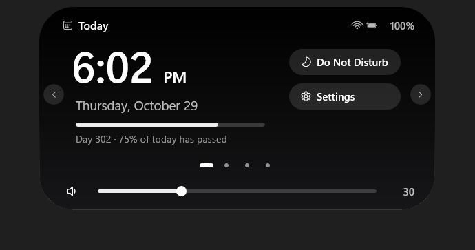
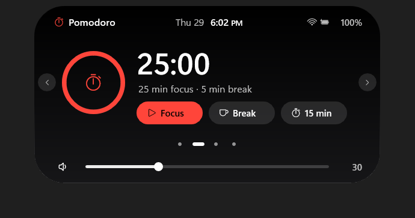
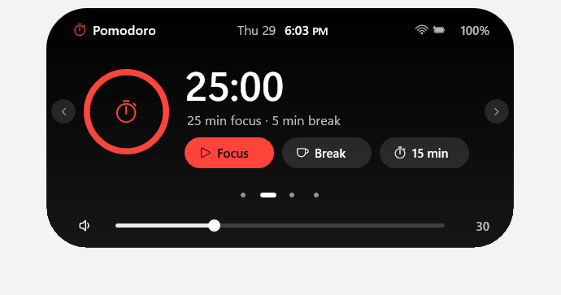
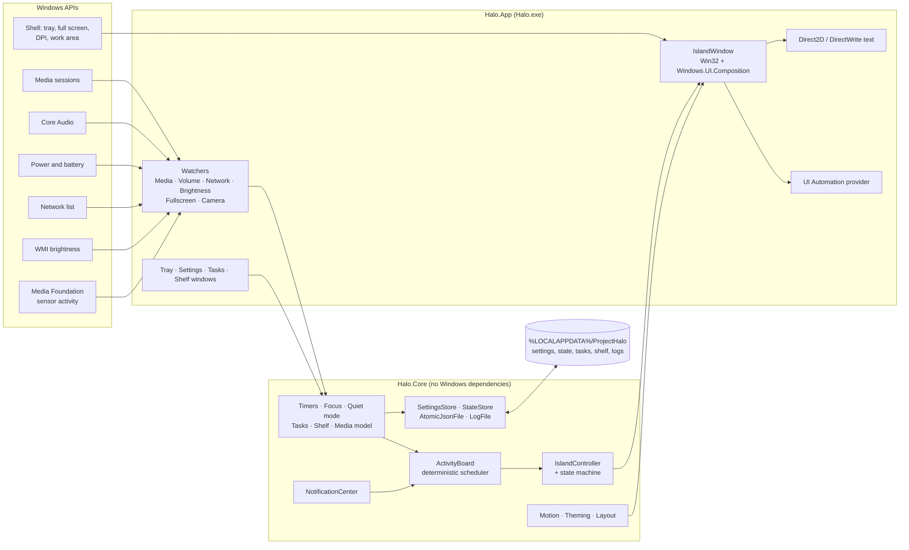

# HaloIsland

**Halo** (Project Halo) is a native Windows desktop utility. It shows ongoing activities, such as a running timer,
music that is playing, a due reminder or a charger being plugged in, at the top centre of the screen.

<p align="center">
  
</p>

> **Status: early development, source only.** There is no signed installer or binary release yet. You can build
> and run Halo yourself from this repository (see [Build and run](#build-and-run)).

## What Halo does

Windows has no single, glanceable place for things that are happening right now. Timers, playback, charging, network
changes and reminders each live in a different window, tray icon or toast. Halo gathers them into one small surface at
the top of the screen. It has three presentations:

| Presentation | What it is |
|---|---|
| **Thin line** | When nothing is happening, Halo is a short line at the top edge. Clicks next to it or below it reach the app underneath. |
| **Compact pill** | When an activity starts, the line grows into a floating pill that shows the most important activity. A second activity appears in a small detached bubble. |
| **Expanded island** | Hover or click to open the island: the clock, Pomodoro, to-do and shelf pages, media controls and a volume slider. |

Halo is an independent Windows project. Its interaction model is inspired by Dynamic Island-style "live activity"
patterns. It is not affiliated with, endorsed by or sponsored by Apple Inc. or Microsoft Corporation. Dynamic Island
is a trademark of Apple Inc.

## Screenshots

All screenshots are from the running application, captured by the project's own test harness.

| Thin line (idle) | Compact pill with a timer |
|---|---|
|  |  |

| Expanded: Today | Expanded: Pomodoro |
|---|---|
|  |  |

| Two activities at once | Light theme |
|---|---|
|  |  |

More captures, including the reduced-motion variants, are in [`docs/visual/`](docs/visual/).

## Features

Each feature below is implemented and covered by automated tests. Labels mark anything partial, optional or
unverified. The full per-feature register, with test evidence, is in
[`docs/PROJECT_STATUS.md`](docs/PROJECT_STATUS.md).

**Island and activities**
- Thin-line idle mode, a floating compact pill and an expanded island, with hover-intent (120 ms dwell, 400 ms grace)
  and click-to-pin.
- Concurrent activities with one deterministic scheduler (critical → urgent → picked → priority → running → relevance
  → first started). A second activity is shown in a detached bubble; clicking it swaps the two without taking focus.
- Activity lifecycle: end, dismiss, expiry, provider stop and history. Optional automatic rotation (`rotateActivities`,
  off by default).
- In-island pages: Today (clock, day progress, Do Not Disturb, Settings), Pomodoro, To-do and Shelf.

**Activities and status**
- **Media:** now playing and playback controls (play/pause, next, previous, seeking, switching between sessions) for
  apps that publish a Windows media session. Tested with test doubles. A live media session has not been checked by eye.
- **Volume:** a volume pill and a slider in the open island.
- **Focus / Pomodoro timer** and countdown timers, with focus sessions.
- **Reminders and to-dos:** due times, daily or weekly repeats, snooze, and reminders missed while Halo was closed.
- **Battery and charging** status and low/critical alerts. Transitions were verified with synthetic readings.
- **Network** connectivity and offline alerts. Transitions were verified with synthetic readings.
- **Brightness** indicator for the built-in screen (read-only).
- **Bluetooth headphone** connection status (connection only; battery is not shown).
- **Camera in use:** off by default. Halo uses Windows Media Foundation's documented sensor activity report and never
  opens a camera itself. Windows' own privacy indicator remains the authority.
- **Shelf:** pin copied text or file references, then copy them back or drag them out. Files are never copied, moved or
  deleted.

**Desktop behaviour**
- Halo's own **Do Not Disturb** (quiet mode), which holds and summarises non-urgent alerts.
- **Full-screen suppression:** Halo hides while a full-screen app or game is in front.
- **Reduce Motion:** follows the Windows "Animation effects" setting, plus a Halo setting.
- Dark and light themes, compact-pill content options, vertical offset, and an optional global shortcut
  (Ctrl+Alt+H, Ctrl+Alt+Space or Ctrl+Shift+H; off by default).
- Tray icon, settings window, tasks window and shelf window.
- **Accessibility:** a custom UI Automation provider exposes the island as a button with Invoke and ExpandCollapse, and
  raises announcements for alerts. UIA delivery is tested; listening with Narrator has not been done.
- **Native rendering:** a Win32 window with `Windows.UI.Composition` visuals and Direct2D/DirectWrite text. No web view
  and no UI framework.
- Persistent local settings and state; single instance; `Halo.exe --exit` closes a running island.

**Not supported (by design or blocked)**
- Halo does **not** read other apps' notifications. That needs package identity and an explicit user opt-in, and it is
  not enabled.
- **No microphone-in-use indicator.** Windows has no documented API for it.
- No universal download, call or navigation tracking.
- Mail and calendar providers exist only as tested interfaces. No account sign-in is wired up.

## Architecture

The solution is split into a platform-free core and a thin Windows host:

- **`src/Halo.Core`** (`net10.0`, base class library only): island state machine and controller, activity board and
  scheduler, notification center, timers, tasks, shelf, motion curves, theming and settings storage. All logic runs
  against injectable clocks, so it is unit-tested in virtual time.
- **`src/Halo.App`** (`net10.0-windows10.0.19041.0`, `Halo.exe`): the Win32 host window, composition visuals, text
  rendering, the UI Automation provider, the tray icon, the native settings, tasks and shelf windows, and the
  "watchers" that turn Windows events into core inputs.



Design records: [`ARCHITECTURE_DECISION_RECORD.md`](docs/ARCHITECTURE_DECISION_RECORD.md) (stack and component model),
[`LIVE_ACTIVITY_ENGINE_2_DESIGN.md`](docs/LIVE_ACTIVITY_ENGINE_2_DESIGN.md) (activity scheduling),
[`MOTION_SYSTEM.md`](docs/MOTION_SYSTEM.md) and [`VISUAL_EXPERIENCE_2.md`](docs/VISUAL_EXPERIENCE_2.md).

## Requirements

| | |
|---|---|
| **Operating system** | Windows 10 version 2004 (build 19041) or later, x64, is the API target. Halo has been developed and tested **only on Windows 11**. Windows 10 is untested. |
| **To run** | .NET 10 Desktop Runtime (x64) |
| **To build** | .NET SDK **10.0.403** or a later 10.0.4xx patch (pinned in [`global.json`](global.json)) |
| **To build the development MSIX (optional)** | Windows SDK 10.0.26100 (`makeappx.exe`, `signtool.exe`) |

No Visual Studio workload is required. The Windows API projections come from the .NET SDK's Windows targeting pack.

## Build and run

PowerShell, from the repository root:

```powershell
# Optional: turn off .NET CLI and test-platform telemetry for this session
$env:DOTNET_CLI_TELEMETRY_OPTOUT = '1'
$env:TESTINGPLATFORM_TELEMETRY_OPTOUT = '1'

git clone https://github.com/Ajaykumar-Mallameeda/HaloIsland.git
cd HaloIsland

dotnet restore Halo.slnx --locked-mode
dotnet build Halo.slnx -c Release --no-restore

# Run the island (unpackaged)
.\src\Halo.App\bin\Release\net10.0-windows10.0.19041.0\Halo.exe
```

- Right-click the island, or use the tray icon, and choose **Exit Halo** to quit. `Halo.exe --exit` also closes a
  running island.
- Starting `Halo.exe` again while it is running expands the running island. Only one instance runs.
- On Windows 11, a new tray icon starts in the overflow flyout. Drag it to the taskbar to keep it visible.

Everything listed under [Features](#features) works when Halo runs unpackaged.

## Development packaging (optional)

`packaging/` contains scripts that build a **development-only** MSIX for local testing. This is not a release
package: it is signed with a self-signed certificate that the script creates on your machine.

```powershell
# Builds artifacts\msix\Halo-dev.msix and exports the public certificate next to it.
.\packaging\build-msix.ps1 -Version 0.1.0.0

# Installs it. Needs an elevated PowerShell, because Windows installs a sideloaded package only when
# its signing certificate is in the machine's Trusted People store.
.\packaging\install-dev.ps1

# Uninstall; -RemoveCertificate (elevated) also removes the certificate from Trusted People.
.\packaging\uninstall-dev.ps1 -RemoveCertificate
```

What to know before using it:

- The certificate is created **by you, on your machine** (`CN=ProjectHalo Dev`, current user store). Its private key
  never leaves the Windows certificate store. Only trust a certificate you created yourself; never import a
  `.cer` file that someone else sends you.
- `install-dev.ps1` adds that certificate to **Trusted People** for the whole machine. Remove it with
  `uninstall-dev.ps1 -RemoveCertificate` when you no longer need it.
- Package identity is not needed for any current feature. It exists to prepare for future packaged releases.
- The development package identity (`ProjectHalo.Island.Dev`) is for local testing only. Future public releases will
  use a different identity and a real signing route, and will be published separately.

This repository does not ship any MSIX, certificate or installer.

## Settings and privacy

- Open **Settings** from the tray menu or from the Today page.
- Settings and data are stored per user in `%LOCALAPPDATA%\ProjectHalo` as JSON files: `settings.json`, `state.json`,
  `tasks.json` and `shelf.json`. Nothing roams or syncs.
- **No accounts, no cloud backend and no telemetry.** Halo makes no network requests. It only reads the connectivity
  state that Windows reports.
- The diagnostic log (`%LOCALAPPDATA%\ProjectHalo\logs\halo.log`, rolled at 1 MB, at most 5 files) contains event
  names, counts and fixed tokens only. Task text, reminder text, media titles, file names and notification content are
  never logged.
- **Show private text** (`showPreviews`) is **off by default**. While it is off, reminder and task text is hidden in
  the pill, alerts and UI Automation names.
- The camera indicator is **off by default**. When it is on, Halo keeps only "another app is streaming a camera" and a
  count. It never reads app names or device names, and keeps no history.

Threat model and data inventory: [`docs/SECURITY_AND_PRIVACY_DESIGN.md`](docs/SECURITY_AND_PRIVACY_DESIGN.md).

## Testing

```powershell
# Unit tests (Core, App and spike projects). Safe to run anywhere, including CI.
dotnet test --solution Halo.slnx -c Release -- --filter-not-trait "Category=Integration"

# Island desktop tests. These start Halo.exe, move the mouse, click and open the tray flyout.
dotnet test --project tests/Halo.App.Tests/Halo.App.Tests.csproj -c Release -- --filter-trait "Category=Integration"

# Spike desktop tests
dotnet test --project spikes/tests/Halo.Spikes.Tests/Halo.Spikes.Tests.csproj -c Release -- --filter-trait "Category=Integration"
```

- Run the desktop suites one at a time on an interactive desktop, and do not use the mouse or keyboard while they run.
- The desktop suites need real input injection (`SendInput`), so they cannot run in sandboxed shells or hosted CI.
- CI runs the restore, the Release build and the unit tests only ([`.github/workflows/ci.yml`](.github/workflows/ci.yml)).
- The build treats warnings as errors.

Test strategy: [`docs/TESTING_STRATEGY.md`](docs/TESTING_STRATEGY.md).

## Current limitations

These are open items from the current evidence; details are in [`docs/PROJECT_STATUS.md`](docs/PROJECT_STATUS.md).

- **Primary monitor only.** Multi-monitor and mixed-DPI behaviour is untested. Manual checks at 100/150/175 % scaling
  have not been done.
- **Windows 10 untested.** Development and testing used Windows 11 only.
- **Accessibility:** UI Automation events are verified by tests, but no one has listened with Narrator yet. High
  contrast has not been checked by eye. Keyboard focus navigation inside the island is not built yet.
- **Media:** playback was tested with test doubles. A live media session has not been checked by eye. Music-playing
  performance (PB-04) has not been measured.
- **Performance:** smoke measurements show low idle CPU and memory, but no formal frame-pacing (PB-05) or wake-up
  (PB-02) verdict exists for the product island. 60 Hz validation is open.
- **Battery and network** transitions were verified with synthetic readings, not by unplugging or disconnecting.
- Not built: Start with Windows, an installer, Windows toast notifications, mirroring other apps' notifications,
  mail and calendar sign-in, keyboard indicators, and a microphone indicator.
- No signed release exists. Building from source is the only supported way to run Halo today.

## Contributing

Contributions are welcome. Please read [`CONTRIBUTING.md`](CONTRIBUTING.md) before opening a pull request, and follow
the [Code of Conduct](CODE_OF_CONDUCT.md). UI changes need before/after screenshots, and every change must keep the
build at zero warnings and the unit tests passing.

## License and attribution

Halo is released under the [MIT License](LICENSE). Copyright © 2026 Ajaykumar Mallameeda.

- Third-party NuGet packages keep their own licenses. The shipped app depends only on `System.Management` (MIT,
  Microsoft). The test projects use xUnit.net v3 (Apache-2.0) and FlaUI (MIT).
- Halo uses the Windows system fonts (Segoe UI Variable, Segoe Fluent Icons) without redistributing them.
- All screenshots in `docs/visual/` were captured from Halo itself.

## Security and support

- **Security issues:** please do not open a public issue. Follow [`SECURITY.md`](SECURITY.md).
- **Questions and bugs:** see [`SUPPORT.md`](SUPPORT.md).
- **Changes:** see [`CHANGELOG.md`](CHANGELOG.md).
